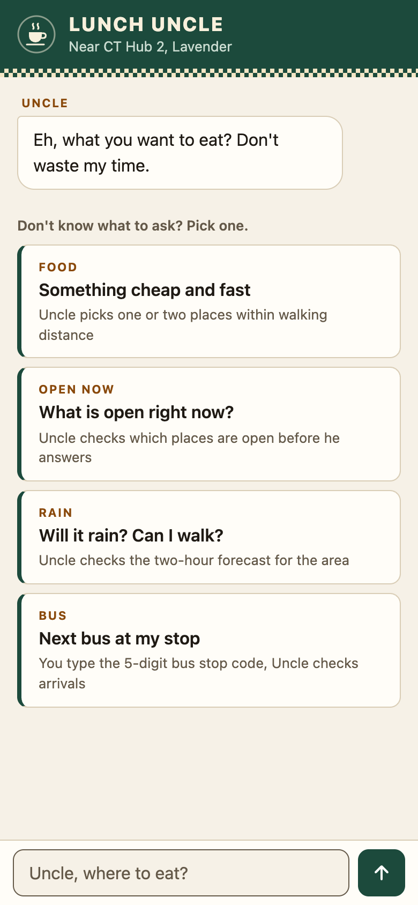
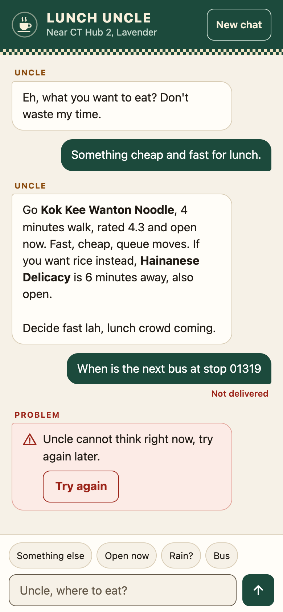
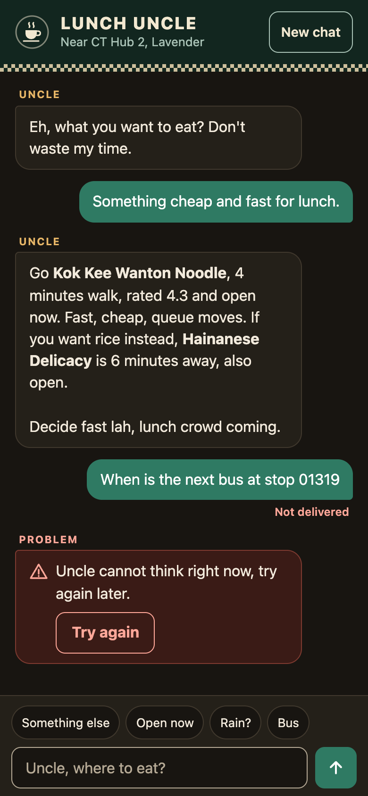
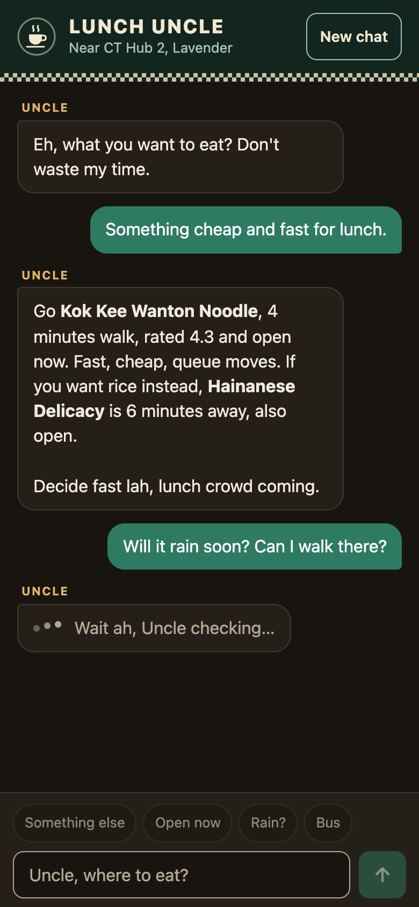
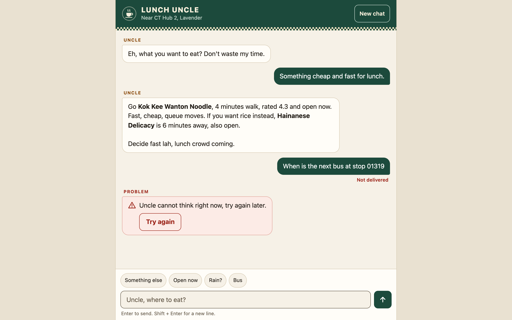
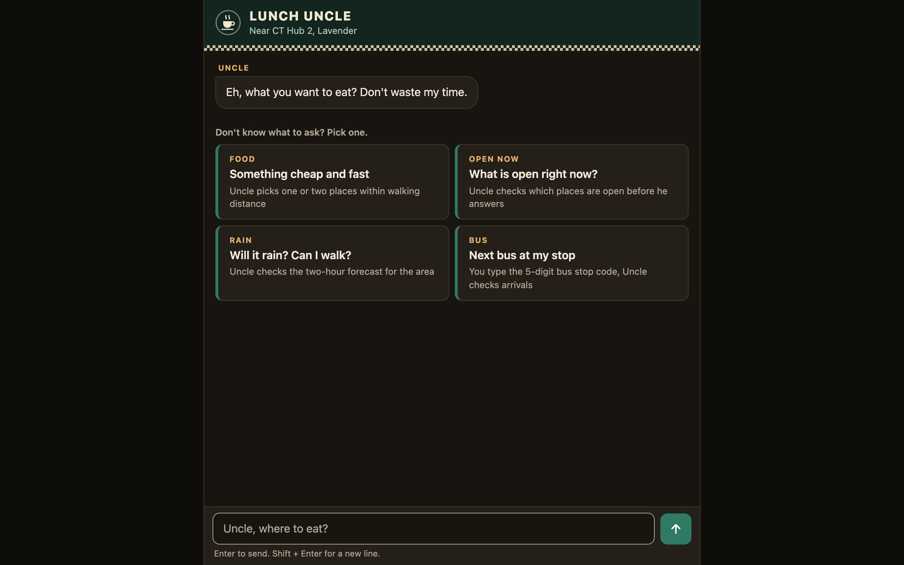

# Lunch Uncle chat UI: review and redesign

Scope: `src/ui.html` only. The `/chat` contract (`{history, message}` in, `{reply}` or `{error}` out) is unchanged.

## Screenshots

| Mobile, light, first screen | Mobile, light, error and retry | Mobile, dark, error and retry | Mobile, dark, thinking |
| --- | --- | --- | --- |
|  |  |  |  |

Desktop, light: 

Desktop, dark, first screen: 

Taken in headless Chrome against a mock `/chat` server with canned replies (390 x 844 and 1280 x 800, 2x).

## Heuristic review of the old UI

Ranked by how much each one hurts someone deciding lunch on a phone.

1. **Capabilities are undiscoverable.** The first screen is one greeting and an empty box. Nothing says Uncle can check rain, bus arrivals or what is open now, so two of the three tools are effectively never used.
2. **Errors look like replies and are a dead end.** A 500 renders in the same yellow bubble as an answer, with no retry. Worse, the error text is pushed into `history` as an assistant turn, so the next request sends "Uncle cannot think right now" back to the model as if Uncle had said it.
3. **No feedback during long waits.** "Uncle thinking..." is static for up to 20 s or more. There is no motion, no reassurance and no client timeout, so a hung request waits forever.
4. **Not usable with a screen reader.** No live region, so replies are never announced. The input has only a placeholder, no label. The scroll area is not keyboard focusable.
5. **Layout breaks on phones.** `height: 100vh` puts the input under the browser toolbar on iOS and Android. `autofocus` opens the keyboard on load and covers the page. No safe-area padding.
6. **Conversation is fragile, and also cannot be reset.** A reload or an accidental back-swipe loses everything, yet there is no deliberate way to start over.
7. **No dark mode.** A white page at full brightness for anyone whose phone is set to dark.
8. **No personality.** Tailwind-default yellow and blue bubbles; nothing says kopitiam or Uncle apart from the copy.
9. **Input is a single-line `<input>`.** Longer questions scroll sideways, and the Send button is under the 44 px touch target.
10. **Model markdown shows raw.** Models often wrap place names in `**`; they render as literal asterisks.

## Design direction

**Idea: the stall signboard.** A kopitiam stall has a plain painted signboard, a tiled floor and a man who answers fast. The page borrows the materials, not the cliches: a deep cup-green sign with cream capitals, one strip of checkered floor tile under it, marble-cream surfaces, and kopi-brown small labels. No mascot, no lanterns, no Singlish in the chrome beyond what Uncle himself says. The personality lives in Uncle's lines (greeting, waiting lines), and the interface stays quiet around them.

**Type.** System UI stack only (no web fonts allowed, and it loads instantly on office wifi). Character comes from treatment: the title is 800 weight, uppercase, 0.08em tracked like sign lettering; category labels are 11 px, 700, 0.1em tracked. Body is 16 px / 1.45, which also stops iOS zooming the input on focus.

**Spacing.** 4 px base: 4, 8, 12, 16, 24. Bubbles 16 px radius with one squared corner on the speaker's side; controls 10 px radius. Touch targets 44 px (quick chips 36 px high, spaced 6 px apart).

**Colour tokens.** Contrast ratios are against the background the token is used on.

| Token | Light | Dark | Use | Contrast (light / dark) |
| --- | --- | --- | --- | --- |
| `--bg` | `#f6f1e7` | `#181511` | page, input fill | |
| `--bg-outer` | `#e9e1d1` | `#0f0d0a` | desktop gutters | |
| `--surface` | `#fffdf8` | `#242019` | Uncle bubble, cards, composer | |
| `--ink` | `#1f1a14` | `#f2eadc` | body text | 15.3 / 15.2 on bg |
| `--muted` | `#645949` | `#b5a995` | helper text, input border | 6.1 / 7.9 on bg |
| `--line` | `#d9cdb6` | `#40382d` | hairlines | decorative |
| `--accent` | `#1c4a3c` | `#2f7a63` | user bubble, send button | white on it: 10.0 / 5.1 |
| `--sign` | `#1c4a3c` | `#12261f` | header | |
| `--sign-ink` | `#f8f0dc` | `#f2e8d0` | header title | 8.8 / 13.0 |
| `--sign-muted` | `#c9dbd0` | `#a9c2b6` | header subtitle | 6.9 / 8.4 |
| `--tile` | `#f3e6c6` | `#cdbf9c` | tile strip | decorative |
| `--tag` | `#8a4a0c` | `#e6b566` | small caps labels | 6.1 / 9.7 on bg |
| `--danger` | `#9b2318` | `#ffa799` | error text, retry | 6.9 / 8.3 on danger-bg |
| `--danger-bg` | `#fcebe6` | `#3a1b16` | error bubble | |
| `--danger-line` | `#e2a69c` | `#7d3a30` | error border | decorative |
| `--focus` | `#1c4a3c` | `#8fd6bc` | focus ring | 8.9 / 10.8 on bg |

Red is reserved for failure. Nothing else on the page is red, so an error cannot be mistaken for a reply.

## Decisions

| Change | Why |
| --- | --- |
| **Four starter cards** on the first screen: Food, Open now, Rain, Bus. Each has the question plus one line saying what Uncle does with it. | Fixes discoverability with the user's own words. Maps one-to-one to real backend capabilities; promises nothing the API lacks. |
| The **Bus** card prefills "When is the next bus at stop " and focuses the input instead of sending. | The tool needs a five-digit stop code only the user knows. I did not hardcode a nearby stop code because I could not verify one. |
| **Quick follow-up chips** above the input once a chat starts: Something else, Open now, Rain?, Bus. | Keeps the three capabilities one tap away mid-conversation. "Something else" is the most common second turn. |
| **Thinking bubble**: three bobbing dots and a line that changes every 3.5 s ("Uncle thinking…", "Wait ah, Uncle checking…", "Good answer cannot rush.", ...). | Motion shows it is alive; changing copy reassures over a 20 s wait and is the main place Uncle's voice shows up in the chrome. Lines are neutral about which tool is running because the client cannot know. |
| **60 s client timeout** with its own message. | A hung request used to wait forever. 60 s leaves headroom over the ~20 s typical worst case. |
| **Error bubble**: red tint, warning icon, "Problem" label, **Try again** button. The failed user message is marked "Not delivered". | Distinct by colour, icon and label (not colour alone). Retry resends the same message in place. |
| **Failed turns are not added to `history`.** | Bug fix: error text no longer goes back to the model as an Uncle reply. |
| **New chat** button in the header, shown once a chat exists; first tap turns it into "Clear chat?" for 4 s, second tap clears. | A deliberate reset without a modal and without one-tap data loss. Clearing also aborts an in-flight request. |
| **Chat is kept in `localStorage` for 6 hours.** | Survives reload and tab eviction on phones; expires so yesterday's lunch does not greet you today. Storage failures are swallowed. |
| **Only the last 20 messages are sent as `history`.** | Now that chats persist, an unbounded history would grow every request. Same contract, bounded cost. |
| **Textarea that grows to about five lines**; Enter sends, Shift+Enter breaks, IME composition respected; `enterkeyhint="send"`. The Enter hint shows only on hover-capable devices. | Sensible on both phone and desktop keyboards. |
| **Focus the input on load and after replies only with a fine pointer.** | On phones, autofocus opens the keyboard over the starter cards and the reply. |
| **`100dvh` with `100vh` fallback, `visualViewport` sizing, `interactive-widget=resizes-content`, safe-area padding.** | Keeps the composer visible under mobile browser chrome and above the keyboard. Skipped while pinch-zoomed so zoom still works. |
| **Accessibility**: `role="log"` live region for messages; a separate polite status line says "Uncle is thinking" once and "still working" at 12 s, while the animated bubble is `aria-hidden`; real `<label>`; focusable, labelled scroll region; visible focus rings; speaker name on every message (visually hidden for "You"). | Replies are announced once, not on every rotating line. |
| **`prefers-reduced-motion`** removes the dot bob, message fade and smooth scroll. Waiting lines still change (text, not motion). | |
| **`**bold**` is rendered** as `<strong>` built from DOM nodes. | Place names read cleanly. No `innerHTML` anywhere; all model and user text goes through `textContent` or text nodes. |
| **Desktop**: single 44 rem column on a darker gutter, starter cards two-up. | Line length stays readable; it still reads as a counter, not a dashboard. |
| No `mockup.html`. | The real page is the mockup. |

## Future proposals needing backend changes

- **Streaming replies** (SSE or chunked) and **tool-progress events**, so the waiting line can say truthfully "checking rain" or "checking places" and the first words appear within a second or two.
- **Structured place data** alongside `reply` (`places: [{name, rating, walkMinutes, openNow, mapsUrl}]`): would allow place cards with an "Open in Maps" link and an open/closed badge. Today the UI cannot link to a place because it only has prose.
- **Nearby bus stops** endpoint or tool (stops around CT Hub 2 with codes and names), so the Bus card can offer real stops instead of asking for a code.
- **Passive rain status**: a cheap `GET /rain` the header could show as "Dry for the next 2 h" without spending an LLM call.
- **Distinct error codes** (`rate_limited`, `upstream_timeout`, `bad_request`) so the UI can say whether retrying will help, and a `Retry-After` hint.
- **Server-side history cap and message length limit**, matching the client's 20 messages and 500 characters, so the limits are enforced rather than advisory.
- **Preference memory** (halal, vegetarian, budget) as a small `prefs` field sent with each request and honoured in the prompt; the UI would add a compact toggle row.
